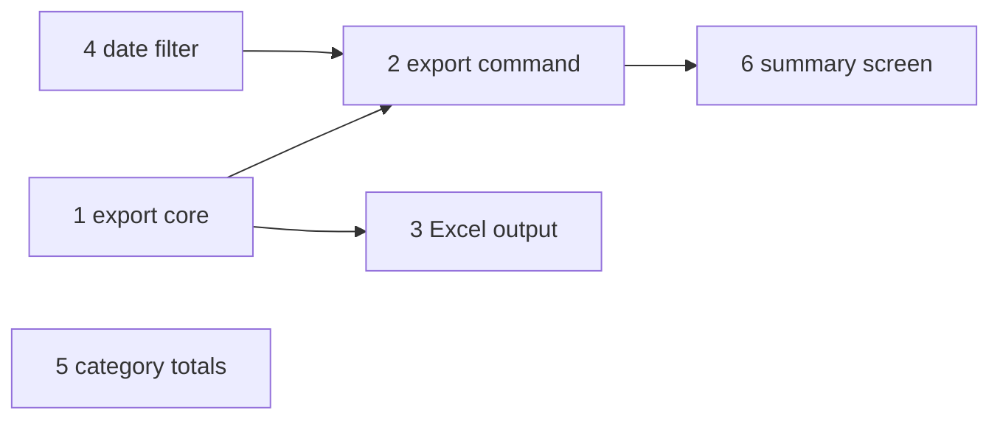

# Export milestone

Status: proposed · Owner: Dana · Milestone: `Export` · Scoped in an
interview on 2026-10-07.

Teams leave ledger for their accountant's spreadsheet every month, and today
they copy totals by hand. `ledger export` writes an account's transactions to
CSV or Excel for a date range, with category totals, and tells the user what
it wrote.

## Scope

- `ledger export ACCOUNT --from DATE --to DATE --format csv|xlsx --out PATH`.
- CSV through the standard library; Excel through `openpyxl`, the one new
  dependency.
- A totals block per category at the foot of the file.
- After writing, a summary on screen: rows written per account, the file path,
  and a prompt before overwriting an existing file.

Non-goals: scheduled exports, Google Sheets, importing back from a spreadsheet.

## Issues

In dependency order. `#` is the position until the issues exist on GitHub.

| # | Title | Scope | Owns | Depends on |
| --- | --- | --- | --- | --- |
| 1 | Export core: the CSV writer | Rows to CSV with a fixed column order (date, payee, category, amount); amounts as plain decimals; unit tests | `src/ledger/export.py`, `tests/test_export.py` | |
| 2 | The `ledger export` command | The command and its flags, wiring the writer and the date filter; exit codes; CLI tests | `src/ledger/cli.py`, `tests/test_cli.py` | 1, 4 |
| 3 | Excel output | `--format xlsx` through `openpyxl`, added to `pyproject.toml`; one sheet per account | `src/ledger/xlsx.py`, `pyproject.toml`, `uv.lock` | 1 |
| 4 | The date-range filter | Parse `--from` and `--to` (ISO dates, `today`, `-30d`); inclusive range; unit tests | `src/ledger/dates.py`, `tests/test_dates.py` | |
| 5 | Category totals | A totals block per category at the foot of the export; unit tests | `src/ledger/export.py`, `tests/test_export.py` | |
| 6 | The export summary screen | What the user sees after an export: a table of rows written per account, the file path, and the overwrite prompt | `src/ledger/summary.py`, `tests/test_summary.py` | 2 |

Done when every issue is closed, `ledger export checking --from -30d --format
xlsx --out june.xlsx` writes a file that opens in a spreadsheet with a totals
block, and the summary screen reports what it wrote.
